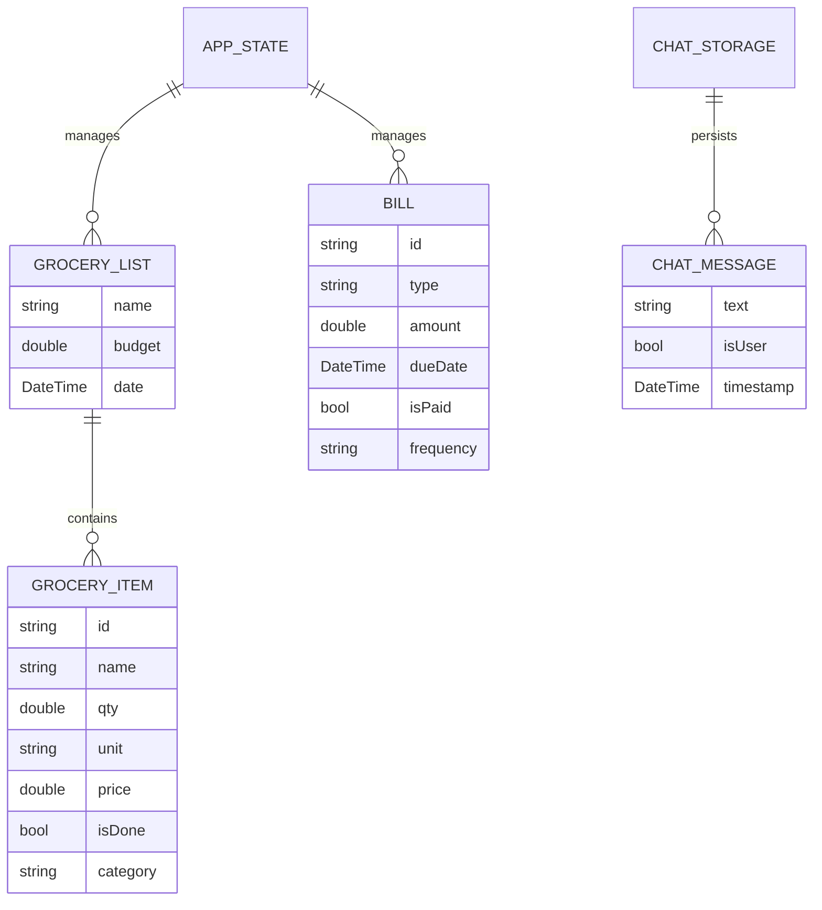

# Technical Documentation: Grocery Wallet

This document provides a comprehensive technical overview of the Grocery Wallet mobile application, detailing its architecture, data models, system integrations, and core features.

## System Architecture

The application follows a modular view-based architecture in Flutter. It employs robust local persistent storage for all its data and integrates with configurable AI services for advanced functionalities.

### Components

1. **Presentation Layer**: Built with Flutter widgets, utilizing a custom design system for a premium user experience. Pages include Home, Recent, Analytics, Bills Tracker, AI Chat, and Settings.
2. **State Management & Storage**: 
   - **`GroceryStorage`**: Manages and persists `GroceryList` and `GroceryItem` data using `SharedPreferences`.
   - **`BillStorage`**: Manages and persists `Bill` data for the Bills Tracker.
   - **`ChatStorage`**: Serializes and deserializes JSON-encoded chat history for the AI Assistant.
   - **`SettingsService`**: A `ChangeNotifier` that manages user preferences (currency, theme mode, behavioral toggles) and persists them locally.
3. **AI Integration Service**: Uses a provider-based chat interface (`ChatAiService`). The app supports `GeminiHttpService` (using `gemini-2.5-flash` via REST API) for high-performance cloud AI, as well as `LocalOpenAIChatService` for offline, local AI execution (e.g., Ollama).
4. **Scanner Service**: Integrates camera functionalities with Gemini Vision AI to extract product names and prices from images.

## Data Models

### Entity Relationship Diagram (ERD)

### Model Descriptions

#### GroceryList
Represents a single shopping session.
- **Attributes**: name, budget, items (List), date.

#### GroceryItem
Represents an individual product within a shopping list.
- **Attributes**: id, name, quantity, unit, price, completion status (isDone), category.

#### Bill
Represents a recurring or one-time expense managed in the Bills Tracker.
- **Attributes**: id, type (name), amount, dueDate, isPaid, frequency (e.g., Monthly).

#### ChatMessage
Represents a single interaction in the AI Assistant chat.
- **Attributes**: text content, sender type (user/model), timestamp.

## AI Assistant & Vision Implementation

The AI capabilities in Grocery Wallet are powered by a dual-provider system.

### Chat Assistant (Ramsey)
The assistant is initialized with a specialized system prompt that includes:
- Knowledge of the Philippine grocery market and regional pricing.
- Expertise in culinary traditions, especially Filipino recipes.
- Contextual awareness: The assistant is injected with the current state of the user's active grocery list and impending bills, allowing it to provide relevant financial advice or recipe suggestions based on available items.

**Providers**:
- **Gemini REST API**: Uses the `gemini-2.5-flash` model for fast, reliable responses, bypassing traditional SDK quota issues.
- **Local Fallback**: Connects to a local `/v1/chat/completions` endpoint for offline AI processing.

### Product Scanner (`ScannerService`)
Allows users to capture images of products or price tags. The image is sent to the Gemini Vision API, which extracts the product name and price in a structured JSON format, enabling rapid, automated grocery logging.

## Core Feature Modules

### 1. Shopping Management
- **Add Item Interface**: Features a microphone button for voice-to-text input and dynamic, recency-based item suggestions.
- **Real-time Tracking**: Calculates totals dynamically against the established budget.

### 2. Bills Tracker
- Manages upcoming and paid bills.
- Provides visual insertion animations and confirmation dialogs for a polished user experience.

### 3. Settings & Preferences
- **Currency Selection**: Supports multiple global currencies (₱, $, €, etc.).
- **Theme Customization**: Light and Dark mode toggles.
- **Behavioral Toggles**: Budget alerts, smart suggestions, and compact view preferences.
- **Data Management**: Polished, animated dialogs for resetting application data.

### 4. Analytical System
Processes historical `GroceryList` data to generate:
1. **Spending Trends**: Line charts showing expenditure over time.
2. **Category Breakdown**: Donut charts showing the distribution of spending (e.g., Meat, Vegetables, Pantry).
3. **Budget Performance**: Comparative bar charts of planned budget vs. actual spending.

## Future Considerations

1. **Cloud Synchronization**: Implementing secure user authentication (e.g., Firebase Auth) and cloud database integration to sync grocery lists, bills, and settings across multiple devices.
2. **Advanced OCR**: Expanding the Gemini Vision scanner to parse entire receipts and automatically generate complete `GroceryList` records in one go.
3. **Collaborative Lists**: Allowing multiple users (e.g., family members) to view and edit the same grocery list in real-time.
