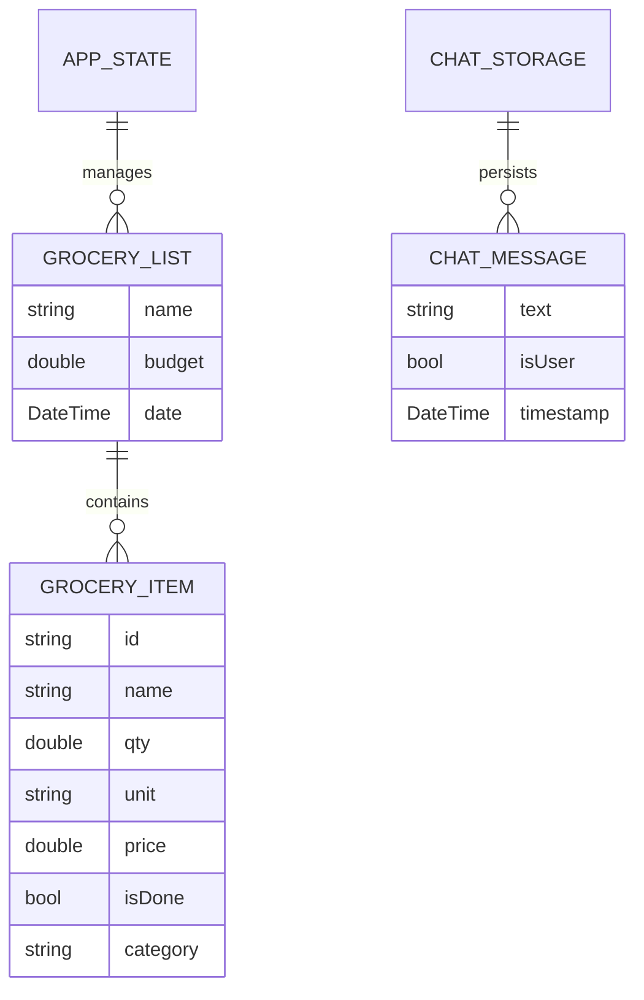

# Technical Documentation: Grocery Wallet

This document provides a comprehensive technical overview of the Grocery Wallet mobile application, detailing its architecture, data models, and system integrations.

## System Architecture

The application follows a modular view-based architecture in Flutter. While currently utilizing an in-memory state management pattern for grocery data, it employs persistent storage for conversational data and integrates with a configurable AI chat service.

### Components

1. **Presentation Layer**: Built with Flutter widgets, utilizing a custom design system for a premium user experience.
2. **State Management**: Handled via the `AppState` class, which manages static collections of grocery lists and recent history.
3. **Storage Service**: Uses `SharedPreferences` to serialize and deserialize JSON-encoded chat history.
4. **AI Integration Service**: Uses a provider-based chat interface. Ramsey defaults to a local OpenAI-compatible API such as Ollama or llama.cpp server, with Gemini still available when configured.

## Data Models

### Entity Relationship Diagram (ERD)

### Model Descriptions

#### GroceryList
Represents a single shopping session.
- **Attributes**: name, budget, items (List), date.

#### GroceryItem
Represents an individual product within a shopping list.
- **Attributes**: id, name, quantity, unit, price, completion status (isDone), category.

#### ChatMessage
Represents a single interaction in the AI Assistant chat.
- **Attributes**: text content, sender type (user/model), timestamp.

## AI Assistant Implementation

The AI Assistant uses a `ChatAiService` abstraction. The default implementation is `LocalOpenAIChatService`, which calls a local OpenAI-compatible `/v1/chat/completions` endpoint for offline chat. `GeminiHttpService` remains available for Gemini-backed chat and image analysis when a Gemini API key is provided.

### System Context
The assistant is initialized with a specialized system prompt that includes:
- Knowledge of the Philippine grocery market.
- Reference pricing for common ingredients in PHP (₱).
- Expertise in Filipino culinary traditions.
- Contextual awareness of the user's active shopping list and budget.

### Context Injection
During every user interaction, the assistant is provided with a formatted string representing the current state of the user's grocery list, allowing it to provide relevant advice such as budget warnings or recipe suggestions based on available items.

## Analytical System

The Analytics module processes historical `GroceryList` data to generate:
1. **Spending Trends**: Line charts showing expenditure over time.
2. **Category Breakdown**: Donut charts showing distribution of spending (e.g., Meat, Vegetables, Pantry).
3. **Budget Performance**: Comparative bar charts of planned budget vs. actual spending.

## Future Considerations

1. **Persistent Grocery Storage**: Transitioning `AppState` to a local database (SQLite/Isar) for persistent grocery lists.
2. **User Authentication**: Implementing secure login to sync data across devices.
3. **Advanced OCR**: Adding receipt scanning capabilities to automatically populate lists.
